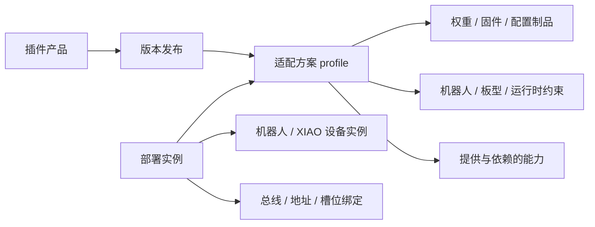

# 插件包格式规范

- 更新：2026-11-12
- 范围：App、plugin_store_server、robopoly 安装器和 MCP。
- 本文同时定义目标规范、代码现状与验证边界；第 12 节逐项区分代码/本机验证、手机实测与未验证项，未列项不视为通过。
- 本机服务端：http://127.0.0.1:8765（部署地址与 App 的 Store Server URL 均可配置）
- 代码依据：App 位于 `../../gki/assets/android_deploy`（实际路径 `/home/robo/gki/assets/android_deploy`）；服务端为 `plugin_store_server/server.py`，App 安装器为 `PluginInstallRepository.kt`。

## 1. 核心模型：分类 + 多目标适配 + 实例绑定

插件关系是多对多的图，矩阵是它的展示方式，不应编码为多层商城菜单。

- 一个动作可以支持多个机器人；每个机器人可以使用多个动作。
- 一个 XIAO 实例可以连接多个外设模块（I2C、UART、GPIO）；同一种模块可以被多个板型支持。
- 一个 RobotD、传感器或模型插件可以服务多个机器人。
- 同一插件可以在不同设备实例上安装不同版本；同一总线上还可能出现多个同型号模块。
- “芯片/板型支持”“固件含驱动”“已接线”“已安装”“已收到有效反馈”是不同事实。

统一区分四种实体：

| 实体 | 标识 | 含义 |
|---|---|---|
| 插件产品 | id | 用户看到的一个插件，如 wave、nst175；不按机器人复制产品 |
| 插件发布 | id + version | 不可变清单及适配方案集合 |
| 适配方案 | profile_id | 一组必须同时成立的机器人、运行时、板型与依赖条件 |
| 部署实例 | instance_id | 实际装到哪台机器人、哪块 XIAO、哪条总线、哪个地址 |

v1 保留五个平面 catalog 分类键：urdf / model / xiao / qwiic / robotd，作为兼容投影，不代表最终分类；目标分类演进见第 6 节。它们不是部署位置，也不是兼容性结论。一个发布只能有一个主分类，允许多个能力标签；v1 中 Qwiic 的主分类为 qwiic，执行目标仍可能是 XIAO。xiao 分类只承载每个 XIAO 板型的基础固件，NST175、ADC、BMS 等模块配置不混入 XiaoLab。

物理机器人与机器人描述插件不是同一个实体。rpo-description 是包 ID，机器人型号、关节契约和实际机器人序列号分别建模。XIAO 板型、固件包、物理板卡也分别标识。



## 2. 前端信息架构

### 2.1 当前实现（2026-11-12 代码与手机验证）

底部导航为五页：**总览 / 交互 / 机器人 / 传感器 / 运维**。导航标签取自 `strings.xml` 的 `nav_home`、`nav_interaction`、`nav_robotlab`、`nav_sensorlab`、`nav_ops`，路由名仍为 `home` / `interaction` / `robotlab` / `sensorlab` / `ops`。

| 页面 | 当前结构 |
|---|---|
| 总览 | 运行总览（连接、模式、运行时长、控制环、IPC 延迟、CAN 丢包）、电机使能/模式与急停、最近日志 |
| 交互 | `手柄` / `NPZ 示教` / `MCP + AI`（MCP + DeepSeek + Skill）/ `装配标定`（含 NFC 零件）四个同级标签 |
| 机器人 | `URDF` / `模型` 两个同级标签；装配模板使用已安装 URDF，本地标定/零件覆盖保留 |
| 传感器 | `SensorLab` / `XiaoLab` 两个同级标签 |
| 运维 | `监控诊断` / `日志` / `开发` / `设置` 四个同级标签 |

- SensorLab 收纳 `mallId == qwiic`、`mallId == robotd` 及旧 `xiao` 非固件条目；XiaoLab 只列 `mallId == xiao && kind == firmware`。
- 插件行当前只含名称、描述、版本/状态、安装/卸载；没有刷写、运行、回滚按钮。`PluginMarketViewModel` 仍保留 `FLASH`/`RUN` 等命令文本枚举，但界面不暴露这些操作。
- 安装是 App 私有 ZIP 安装：`PluginInstallRepository` 只写 `filesDir/installed_plugins`，不调用 shell/root、不执行包内文件、不接触硬件。流程与限制见 §3、§10。root 验证记录：debug 构建成功；已安装到手机并在 `use_cli=false` 下实际下载/安装 `rp-hand-left`，包内 `skill.md`、`assembly.template.yaml`、`SHA256SUMS`、`urdf.yaml` 已核对；卸载已在手机确认：卸载 `rp-hand-left` 后 `files/installed_plugins` 为空，返回交互页 MCP + AI 显示“未安装 skill”。
- 设置集中在 运维 > 设置：Store Server URL、L2 部署目录、控制核配置、遥测频率、Zenoh Router/遥测、MCP 开关/端口/token、MQTT/Matter、WiFi 手柄 keyexpr；DeepSeek 开关、Base URL、模型与 API Key 也在该页，Key 经 AndroidKeyStore 加密后写入 noBackupFilesDir。
- 交互页负责手柄/NPZ/MCP + AI 的输入与控制会话，不执行使能、标定、烧录；相关开关与参数（含 MCP 端口/token、DeepSeek）在运维 > 设置，已安装 Skill 的只读展示在交互 > MCP + AI。

### 2.2 目标信息架构

统一插件页仍是目标，不是当前实现；不得把当前五页写成最终形态，也不得继续使用旧的“总览 / RobotLab / SensorLab / 开发”四页描述。目标统一页：

- 一个统一列表：全部 / 描述 / 动作模型 / 传感器与外设 / XIAO 基础固件 / RobotD 分类筛选；
- 顶部“当前机器人”和“目标设备”上下文选择器；未选目标时显示完整目录，不默认选择第一台机器人；
- 分类和兼容性是同级筛选，不再嵌套 RobotLab → 商城 → 子商城；
- 主列表紧凑行：名称、类型、版本、与当前目标的兼容状态、该目标上的安装状态；机器人支持数量和能力作为辅助信息；搜索覆盖名称、能力和目标型号；
- 详情页：概览（描述、版本、包来源、下载及 skill）、适配（支持的机器人/板型/运行时、profile、缺失条件和验证记录）、部署/绑定（独立上下文页：安装目标、实例绑定、已安装版本、更新与回滚）。

分类含义以第 6 节为准：SensorLab 的传感器插件视图收纳传感器/外设模块（含 I2C、UART、GPIO），XiaoLab 只列各板型基础固件；NST175、ADC、BMS 不放进 XiaoLab，也不因 v1 API 投影被改写为 I2C。

手机适配页默认按目标分组的列表，点一行展开原因；桌面或横屏允许矩阵。矩阵行是插件/profile，列可切换为机器人或板型；运行时与版本作为筛选条件，不把所有维度铺成超宽表。

以当前配置为例，状态必须分别显示：

- 电机未上电、CAN/IMU 未连接属于设备状态。
- 包已下载不代表已安装；已安装不代表已绑定；已绑定不代表在线。
- 声明兼容不代表真机验证通过；缺少实际目标信息时显示“待确认”。

从某个 XIAO 设备点击“添加模块”，进入同一个插件页并预置该实例为目标、分类为传感器/外设（v1 投影为 qwiic）；从机器人点击“添加动作”预置机器人与 model 分类。返回后保留筛选与滚动位置。

插件卡片始终只保留安装/卸载，目标设备上下文选择、绑定与部署放在独立上下文页，不在卡片上增加按钮。刷写、标定、使能和运行仍走独立授权。复制命令必须明确标为复制，不能呈现为已执行。

## 3. 统一包与旧格式的边界

目标统一格式引入 plugin.yaml，使用 package_schema: 2。已有 sensor.yaml / action.yaml / urdf.yaml 继续作为类型专用清单；不要修改它们的 schema_version: 1 来假装旧解析器支持多目标。

```text
<zip root>/
├── plugin.yaml
├── sensor.yaml / action.yaml / urdf.yaml
├── skill.md
├── SHA256SUMS
├── assembly.template.yaml       # URDF 必需
├── configs/
├── firmware/
├── models/
├── motions/
├── urdf/
├── meshes/
└── preview/
```

新格式清单位于 ZIP 根目录。迁移读取器可接受旧包外包一层目录，但只能识别唯一清单根，混合或多清单根必须拒绝。解包不能依赖 ZIP 文件名推导包 ID。

共同要求：

- 发布版本采用 SemVer；local 只用于开发目录，不作为正式发布版本。
- `skill.md` 是单文件，文件名固定为 `skill.md`（不是 `skills/` 目录）。本仓库 action/sensor 标准包加载器均要求根目录存在非空 `skill.md`：缺失报 `skill.md is missing`，仅空白报 `skill.md is empty`。
- sensor 标准包要求 SHA256SUMS 覆盖除自身外每个文件；action 标准包的 `covered_files()` 显式包含 `action.yaml`、`skill.md`、运行时入口、配置、motions/latents 与预览。App 安装器更严格：要求根目录 SHA256SUMS 覆盖解包后除自身外的每个文件，未覆盖即拒绝。
- HuggingFace 外链不是可安装 ZIP，服务端只做 302，不适用 `skill.md`/SHA256SUMS；外部 XIAO GitHub Release ZIP 不保证包含 `skill.md` 或 SHA256SUMS。App 对不满足上述规则的上游包会拒绝安装，服务端也不会替上游补齐。
- catalog 同时给出整个 ZIP 的字节数和 SHA256；包内校验与 ZIP 校验分别验证。
- 拒绝绝对路径、越界路径、符号链接、重复 ZIP 路径及解压后名称冲突；限制文件数与解压总字节数。
- 包不携带密钥。配置/模型/描述包不得安装即执行脚本；现有 sensor 二进制包的源码/脚本禁入规则继续有效。
- 安装、绑定和读取 skill 均不得自动刷写、重启、标定、使能或运行。
- 许可证必须依据原资产保留，未知则标记待核实，禁止自动推断为可再分发，也不自动标为 Proprietary。
- 不支持 package_schema: 2 或 compatibility.schema_version 的安装器只能浏览/下载，拒绝安装、apply、flash、run；不能忽略新字段后当作单目标 v1 执行。

新规范尚未落地前，不向旧安装器直接分发多目标包。服务端可以为选定 profile 生成兼容 v1 的单目标包，但必须保留来源发布、profile 和制品摘要，旧包仍接受原来的安全校验。

## 4. 公共清单

以下为目标字段示意，sample 命名空间是示例，不声明现有硬件兼容性：

```yaml
package_schema: 2
id: sample/wave
name: Wave
version: 1.0.0
category: model
kind: action
description: 多目标动作
manifest: action.yaml
skill: skill.md
capabilities:
  - motion.wave
artifacts:
  - id: wave-rpo
    path: models/rpo/policy.onnx
    media_type: application/onnx
  - id: wave-rp1
    path: models/rp1/policy.onnx
    media_type: application/onnx
checksums:
  algorithm: sha256
  file: SHA256SUMS
safety:
  install_level: D1
  execution_level: S2
  auto_enable: false
compatibility:
  schema_version: 1
  profiles:
    - id: rpo-profile
      target:
        robot_model: sample/rpo
        joint_contract: sample/rpo-joints-v1
        runtime: robotd
        runtime_version: ">=1.0.0 <2.0.0"
      artifacts: [wave-rpo]
      config: configs/rpo.yaml
      requires: []
      provides: []
    - id: rp1-profile
      target:
        robot_model: sample/rp1-24dof
        joint_contract: sample/rp1-24-joints-v1
        runtime: robotd
        runtime_version: ">=1.0.0 <2.0.0"
      artifacts: [wave-rp1]
      config: configs/rp1.yaml
      requires: []
      provides: []
```

id 是规范身份，独立于显示名称、HF repo、Git URL 和本地目录。新 ID 采用 publisher/name；sensor 历史短 ID 通过显式 aliases 映射，不能静默改名破坏已安装记录。HTTP API 通过 URL 编码或 opaque key 传递 ID，不能直接拼接到文件路径。

category 是唯一主分类；capabilities 是搜索与能力声明，不足以证明兼容。artifact 必须引用包内实际文件；将来分离制品时使用受校验的 URL、size、sha256，不能只给目录链接。

安装风险 D0..D3 与动作执行风险 S0..S3 是不同维度；沿用对应旧清单解释，不能由 category 推导。公共层与专用层的重复字段不一致时拒绝发布，不能任选一份。

## 5. 兼容矩阵如何存储与计算

### 5.1 profile 的逻辑

- profiles 之间是 OR；同一个 profile 内所有 target 和 requires 是 AND。
- 同一字段显式给出的 allowed 列表是 OR；不同字段之间仍为 AND。
- 不把 robots、boards、runtimes 三个数组直接做笛卡尔积。不同组合成立条件不同，应拆成独立 profile。
- 同一 payload 可被多个 profile 引用；需要不同权重/关节映射/固件时引用不同 artifact。
- 零个 profile 不是“通用兼容”，而是未声明。版本约束遵循固定 SemVer 比较规则，预发布默认不满足稳定范围。
- target 中缺失的维度表示该 profile 不约束该维度；对该类型强制的维度缺失则清单无效。设备实测信息缺失属于 unknown。
- Model 动作必须约束机器人关节契约、运行时及输入输出契约；XIAO 固件必须约束准确板型与硬件修订；传感器/外设模块必须约束 transport（i2c / uart / gpio）、驱动能力及电气需求；RobotD 二进制必须约束 OS/架构/ABI。
- 不能凭相同 DOF 判定动作兼容。关节顺序、单位、方向、零位、控制频率、observation/action 维度与归一化都属于契约。
- 关节契约引用不可变版本及摘要；自定义机器人必须显式创建适配 profile，不能自动跨机型套动作。

### 5.2 插件依赖与板卡能力

requires 表达必须存在的能力或包，provides 表达该 profile 可提供的能力。能力也有版本，绑定范围不可省略。target.transport 取 i2c / uart / gpio，按模块真实连接决定；不要因 v1 mall 投影把 GPIO/UART 模块写成 i2c。

```yaml
# 示例：I2C 传感器模块的一个适配方案，不代表已有板卡通过验证
id: nst175-i2c
target:
  transport: i2c
requires:
  - capability: bus.i2c.controller
    version: ">=1.0.0 <2.0.0"
    scope: same_device
  - capability: driver.nst175
    version: ">=1.0.0 <2.0.0"
    scope: same_device
provides:
  - capability: sensor.temperature
    version: 1.0.0
binding:
  bus: required
  address:
    default: "0x48"
    allowed: ["0x48"]
```

same_device 的两条依赖必须由所选那块 XIAO 实例满足，不能把板 A 的 I2C 和板 B 的驱动凑成一个匹配。scope 仅允许 same_device / same_robot；跨设备能力使用明确的 provider_instance 绑定并验证传输链路。

XIAO 支持一个 I2C 模块需要同时满足：准确固件版本包含该驱动、端口引脚可用、I2C 电平/供电/速率符合要求、拓扑允许地址分配。Qwiic/STEMMA QT 是连接生态，I2C 是协议，两者不等同。不得因接头相同就判为电气兼容。

XIAO 基础固件通过 provides 声明该固件实际编译并暴露的总线与驱动能力（i2c / uart / gpio），模块包通过 requires 绑定所需能力；provides 必须与固件实际内容一致。不同板型或固件版本的能力集合不同，不能据此宣称所有基础固件都支持所有模块。

UART/GPIO 模块按各自 transport 与电气约束判断，不能套用 I2C/Qwiic 规则；ADC 经 GPIO、BMS 经 UART 时不得标记为 i2c。

模块与机器人通常通过能力依赖关联，无需为通用温度传感器逐一列举所有机器人。某机器人 profile 明确依赖特定测量语义/量程/安装位置时仍需约束，不能把任意温度值或 IMU 当作等价输入。

地址冲突键为 controller_instance + bus + mux_channel_path + address；不同板或不同复用通道相同地址不冲突。部分模块支持改址、多个地址或扫描范围，不能规定“一个包只能有一个固定地址”。i2c-scan 属诊断能力，不占用一个外设地址；扫描操作本身是否允许另行判断。

### 5.3 结果与证据分开

| 匹配结果 | 含义 | 前端处理 |
|---|---|---|
| compatible | 至少一个 profile 的已知条件及依赖全部满足 | 可选择该方案，执行仍需独立门控 |
| needs_dependencies | 目标条件匹配，缺少已知可满足的依赖或绑定 | 展示安装/绑定计划 |
| incompatible | 所有 profile 均存在确定冲突 | 展示失败条件 |
| unknown | 无声明或缺少关键信息，不能决定 | 待确认，不自动运行 |

聚合顺序：存在全部条件满足的方案则 compatible；否则存在已知目标匹配且仅缺依赖的方案则 needs_dependencies；其余有无法判断的方案则 unknown；只有全部确定冲突才 incompatible。空列表固定 unknown。每个结果返回 profile_id、原因码、期望值、实际值和缺失项。

verification 独立存储 declared / simulated / hardware_tested，关联精确包版本、artifact SHA256、profile、目标硬件/固件版本、时间和证据路径。不能用“硬件测试过”覆盖当前目标的确定冲突，也不能把历史测试当作在线健康状态。

多方案同时匹配时不能任选第一项执行：优先使用用户已绑定 profile；否则让用户选择并展示制品差异。依赖图检测环、版本不可满足和排他资源冲突，不能自动无限升级依赖。

## 6. 五类专用清单

| 分类 | 专用清单 | 专用内容 | 适配重点 |
|---|---|---|---|
| urdf | urdf.yaml | 描述入口、网格、可选 MJCF、assembly.template.yaml | 型号、构型、关节契约 |
| model | action.yaml | ONNX/动作数据、I/O 契约、频率、配置 | 每个机器人对应 profile 与制品 |
| xiao | sensor.yaml | 每个板型的基础固件；provides 声明实际编译的总线/驱动能力；不含模块配置 | 精确板型、修订、固件 provides 的能力集合 |
| sensor（v1 投影为 qwiic） | sensor.yaml | I2C/UART/GPIO 模块配置、地址或通道、电气约束；requires 绑定固件能力 | transport、绑定的控制器及总线 |
| robotd | sensor.yaml | 主机配置或驱动、运行时依赖 | OS、架构、ABI、机器人能力 |

分类演进：v1 的五分类键继续作为兼容投影，其中 qwiic 键临时承载原 QwiicLab 的传感器/外设模块以及 XIAO 非固件模块（包括 ADC/GPIO、BMS/UART）；这是旧 API 的投影局限，真实 transport 由包声明保留，UI 呈现为 SensorLab，不能按 qwiic 语义把 GPIO/UART 标成 i2c。目标 schema 用 category: sensor 表示传感器/外设插件，用 transport 区分 i2c / uart / gpio；qwiic 仅作为历史 mall 别名映射到 sensor，robotd 保留为运行时类别。本轮不新增第六商城，也不要求旧安装器理解新语义。

保留旧字段作为单目标兼容信息：

- sensor v1 的 class: xiao / dev 是旧安装器类别，不能等同于商城分类，也不表示该包属于 XiaoLab 基础固件；Qwiic 不能直接把 class 改为 qwiic 后送给仅接受 xiao/dev 的校验器。
- action v1 的 robot.model / robot.dof 只描述一个目标；新 profiles 的多机器人语义不能靠旧字段携带。
- HF repo 是 source/repo 元数据；只有外链时标为“上游资源”，不能把网页 302 当成已验证 ZIP。
- 本地裸 ONNX 由服务端封装为标准 ZIP：根目录包含 model.yaml、非空 skill.md、SHA256SUMS 和原 .onnx 制品；下载响应固定为 .zip，不再以裸 .onnx 分发。
- URDF 清单应列出真实入口与资源路径，检查 mesh 引用可以解析，不使用未展开的通配符。无可视网格的 Hand URDF 应如实标为仅运动学描述。

## 7. 装配模板与本地覆盖

### 7.1 当前实现（App）

- 入口：交互 > 装配标定，包含 NFC 零件管理。模板选择器只读 `filesDir/installed_plugins/<id>/assembly.template.yaml`；该文件由插件安装器随 URDF ZIP 写入。App 不联网生成装配模板，也不导入/导出本地装配包。
- 已安装模板要求安装元数据、目录 id 与商城 id 精确匹配；读取要求 JSON 对象（合法 YAML），且 `robot` 与插件 id 一致。
- 标定参数、零件库（NFC 入库/编辑）与工件由本机各自存储维护，是本地覆盖，不随 URDF 模板包导入/导出；当前没有“装配包导入/导出”界面。`AssemblyPackage` 数据结构存在，但装配页不再生成或导入整包。
- 装配页本身不写电机 Flash；提交标定/置零会向 L2 下发命令，实际写入仍由 L2 授权与执行。

服务端 `/api/v1/malls/urdf/plugins/{id}/assembly` 当前返回的是 schema_version 1 的 JSON 模板（robot、version、descriptions/joints、空 calibration/parts/workpiece），不是下面完整的目标模板；App 装配页读取的是安装包内的 `assembly.template.yaml`，不是该接口。

### 7.2 目标格式

URDF 包中的 assembly.template.yaml 是只读基础模板，包含机器人型号、描述/profile、关节契约、预期槽位与连接关系；不携带某台机器人实测零位、序列号或当前工件。

目标本地 assembly instance（尚未实现）保存：

```yaml
schema_version: 2
instance_id: robot-local-001
template:
  plugin_id: sample/rpo-description
  version: 1.0.0
  profile_id: default
  sha256: "<exact-template-sha256>"
bindings:
  - slot: torso-temperature
    device_instance: xiao-001
    plugin_id: sample/nst175
    plugin_version: 1.0.0
    profile_id: nst175-i2c
    bus: i2c0
    mux_channel_path: []
    address: "0x48"
overrides:
  calibration: []
  parts: []
  workpiece: null
```

绑定引用实例与 profile；不把固件、模块和机器人按显示名称拼起来。锁定文件还要记录依赖的精确版本和制品摘要，保证重建同一装配。

合并优先级：模板默认值 → profile 默认值 → 当前实例允许修改的覆盖字段。覆盖只允许白名单字段，不得覆盖关节契约、风险级别和兼容条件。切换模板先预览差异；关节改名、删除、方向变化时相关标定标为失效并等待确认，禁止默默按数组下标套用。

模板引用、本地覆盖与版本锁定只保存在本地装配记录中，不再规划本地装配包导入/导出。工件按本地实例记录，不能把一次抓取的工件变成所有机器人的模板默认值。当前 App 只保留标定/零件/工件本地覆盖。

## 8. skill 与 MCP

每个标准包必须有非空单文件 skill.md，至少描述能力、接口、输入输出、前置条件、安全限制、支持 profile 和示例。Skill 是说明文本，不是兼容性数据库或授权来源；不得从自然语言猜测支持列表。

当前实现：sensor 包校验器和 action 包校验器均拒绝缺失或空白的 skill.md；action 包在提供 SHA256SUMS 时要求覆盖 `covered_files()`（含 skill.md），sensor 包要求覆盖除自身外全部文件。App 安装器要求根目录 skill.md 非空且 SHA256SUMS 覆盖全部文件。该要求只覆盖本仓库可打包/校验的制品与 App 安装路径，不代表外部上游制品已经符合。

App MCP（`McpServer.kt`，HTTP `POST /mcp`，可选 Bearer token）：

- 方法：`initialize` / `ping` / `tools/list` / `tools/call` / `resources/list` / `resources/read` / `skills/list` / `skills/get`；`notifications/*` 返回 202。
- 工具：已启用的机器人工具，加固定工具 `list_skills` / `read_skill`；resources 的 URI 为 `skill://<URL 编码 id>/skill.md`。
- Skill 来源：`PluginSkillStore` 每次调用重新扫描 App 私有安装目录、`assets/plugins` 暂存目录、action/sensor 缓存中 `current` 指向的版本；空列表是有效结果。当前记录只有 id/name/content/path，尚无 profile 或设备实例上下文。
- 商城预览必须标为未安装，不能拿商城目录冒充已安装。
- 在线模型读到 skill 不等于获得刷写/标定/使能授权。
- 同一包多个实例可复用 skill 文本，但运行上下文必须明确实例（目标能力，尚未实现）。

## 9. Catalog 与 API

现有接口继续兼容：

```text
GET /health
GET /api/v1/catalog
GET /api/v1/malls
GET /api/v1/malls/{mall}[?q=...]
GET /api/v1/malls/{mall}/plugins
GET /api/v1/malls/{mall}/plugins/{id}
GET /api/v1/malls/{mall}/plugins/{id}/skill
GET /api/v1/malls/{mall}/plugins/{id}/download
GET /api/v1/malls/urdf/plugins/{id}/assembly
```

`/api/v1/malls/{mall}?q=` 按 id/name/description 做子串过滤；`/api/v1/malls/{mall}/plugins` 当前忽略 `q`，返回完整列表。完整路由、错误码、缓存与启动方式见 [plugin_store_server/README.md](plugin_store_server/README.md)。

目标新增统一视图，尚未实现：

```text
GET  /api/v2/plugins?category=...&capability=...&q=...
GET  /api/v2/plugins/{key}/versions/{version}
POST /api/v2/compatibility/resolve
```

resolve 输入选定发布、机器人契约、设备实例、固件/能力版本、当前绑定；输出所有候选 profile、聚合状态、原因列表、依赖计划及所用 catalog revision。该接口只计算计划，不能执行部署或控制。

五商城 v1 是 v2 统一目录的分类投影，不能维护五份独立身份。当前 catalog 不返回服务器本地绝对路径；返回制品 download URL、archive_format，以及可用的 size/sha256；URDF 另返回 assembly_template URL；skill 由 App 按 `/skill` 路径拼接。当前 v1 响应没有 schema_version、revision 或兼容矩阵字段；这些是目标，App 离线计算尚不能记录它们。

当前 v1 实现新增 `archive_format`：

- `zip`：本地生成包，或来自 GitHub Releases 的上游 ZIP；下载端返回 `application/zip`。
- `external`：HuggingFace 等外部资源，仅提供外链并 302 跳转；不表示服务端已下载、校验或重新打包。

本地按需生成的 ZIP 在 catalog 中的 ZIP 级 `sha256` 仍可能为 `null`，此时以包内 SHA256SUMS 的逐文件摘要为准；上游 GitHub ZIP 仍按 catalog `sha256` 校验缓存。不得把 `external` 或缺省 ZIP 摘要解释为已验证标准包。

当前 v1 的下载与错误边界：

- 本地生成包 / URDF / Qwiic：返回 `application/zip`，`Content-Disposition` 文件名 `<id>.zip`；本地资产缺失 404 `local asset missing`，打包失败 500 `package failed: ...`。
- HuggingFace 等 `external`：302 跳转 `external_url`，服务端不下载、不校验、不重打包。
- XIAO 上游 GitHub ZIP：按 URL 缓存并校验 catalog `sha256`；失败返回 502 `upstream failed: ...`。
- 未知 mall / 插件返回 404 `mall not found` / `plugin not found`；无可用制品返回 404 `no downloadable asset`。
- HTTP 接口当前无鉴权；`GITHUB_TOKEN` 只用于 GitHub Release 资产，不是 API 访问令牌。

服务端不可用时 App 回退本地 `assets/plugin_catalog.json`，界面显示“本地缓存”来源；缺少矩阵字段的旧记录显示 unknown。服务端兼容计算不能代替安装前本地复核，尤其是总线资源和设备固件已经变化时。

## 10. 安装状态的维度

当前 App 只维护 `plugin_id -> version` 映射，来源为 `InstalledPluginScanner`：App 私有安装目录优先，其次是 `assets/plugins` 暂存、action/sensor 缓存中 `current` 指向的版本。界面据此显示未安装 / 已安装 / 可更新 / 处理中；尚无 target_instance、profile、binding、runtime 或 verification 维度。

目标状态主键为 plugin_id + target_instance + profile_id，不得继续只用 plugin_id → version 表示所有设备。

分别记录：

- acquisition：未下载 / 下载中 / 已校验 / 失败。
- deployment：未安装 / 已安装 / 可更新 / 安装失败，附具体目标与版本。
- binding：未绑定 / 已绑定 / 冲突。
- runtime：未知 / 离线 / 在线 / 故障，附观测时间与来源。
- compatibility：第 5 节结果及原因。
- verification：声明、仿真、硬件验证证据。

目标未选目标时可以显示“已安装到 2 个设备”，不能显示一个含糊的绿色“已安装”。模型云端来源、下载成功、声明兼容均不能伪装成部署成功。当前 App 的“已安装”只表示 App 私有目录或已知缓存中存在该 id/version，不代表已绑定或在线。

## 11. 迁移顺序与验收

1. 注册 ID、型号、板型、能力和关节契约；为历史 ID 建立明确别名表。
2. 实现公共清单 schema 与拒绝未知版本的加载器，再允许发布多目标包；现有 v1 包保持单目标读取。
3. 拆分 XIAO 基础固件与模块包：每个板型一份基础固件，只用 provides 声明实际编译的总线/驱动能力；NST175、ADC、BMS 等模块包移出 XiaoLab，改用 requires 绑定所需能力。前端按最终确认合并为 SensorLab，XiaoLab 只保留基础固件；v1 的 qwiic key 作为兼容投影保留，等目标 schema 落地后再迁移。
4. 实现 profile 解析、版本约束、作用域与冲突检查，输出统一原因码；服务端/App/安装器共用测试向量。
5. Catalog 添加公共元数据，五商城变成投影；不从命名或目录位置推断兼容性。
6. App 引入目标上下文和实例状态，再迁移到统一插件页；旧 Lab 可暂时作为带预设筛选的入口。
7. 装配实例引入模板版本锁定、绑定和覆盖迁移；完成后再移除旧静态教程/目录入口。
8. action 与 sensor 标准包已强制非空 skill.md 并校验 SHA256SUMS 覆盖；本地 URDF、外设与 ONNX 模型由服务端生成含 skill.md、清单和 SHA256SUMS 的 ZIP；App 安装器对下载的 ZIP 再次执行 skill.md、SHA256SUMS 和清单一致性校验。HF 仍仅为外链；XIAO 上游包仍属第三方，不断言其包含 skill.md 或已完成本地重打包。
9. 最后增加发布门禁和矩阵视图，不用前端筛选代替部署安全检查。

必须覆盖的验收案例：

| 场景 | 预期 |
|---|---|
| 一个动作两个机器人、不同权重 | 一个产品，两条 profile；准确选择各自 artifact |
| 相同 DOF、关节顺序不同 | 不匹配，或必须使用显式适配契约 |
| XIAO 板型相同、固件缺少模块驱动 | 缺依赖或不兼容，不显示直接可用 |
| 两条依赖分别由不同 XIAO 提供 | same_device 不满足 |
| 两个同址模块接不同总线/复用通道 | 不误报地址冲突 |
| 同一物理总线同地址重复绑定 | 阻止绑定并给出冲突实例 |
| 旧包无兼容声明 | unknown；不自动扩大兼容范围 |
| 多个 profile 同时匹配 | 使用明确绑定或要求选择 |
| 模板升级删改关节 | 本地标定不静默迁移 |
| 包已下载但没有 L2/硬件 | 只显示下载状态，不显示运行成功 |
| 离线 catalog 与在线不同 | 显示来源/revision，安装前重新复核 |
| 未知 schema 或循环依赖 | 拒绝执行并给出原因 |

## 12. 当前实现快照与差距

本节是 2026-11-12 的代码、本机与手机验证快照；只记录已确认项，未列项不代表通过。

| 项目 | 已有实现 | 尚缺 |
|---|---|---|
| catalog | v1 API；archive_format（zip/external）；2026-11-12 从运行中的 8765 `/health` 与代码 import 核对：urdf 4 / model 25 / xiao 14 / qwiic 7 / robotd 1（共 51）；SensorLab 合并 qwiic 7 + robotd 1 = 8。数量随本地 URDF 根、build 模型目录、sensor_bundles 变化，不是固定常量。 | 公共 plugin.yaml、profile 矩阵、revision、v2 resolver、sensor/transport 目标 schema、生成 ZIP 的 catalog 级 sha256 |
| App | 在线 catalog、Store Server URL、本地回退；底部五页 总览 / 机器人 / 传感器 / 交互 / 运维；机器人 = 装配与标定 / URDF / 模型；传感器 = SensorLab / XiaoLab；交互 = 手柄 / NPZ 示教 / MCP + AI；运维 = 监控诊断 / 日志 / 开发 / 设置。插件行仅名称、描述、版本/状态、安装/卸载。App 私有 ZIP 安装器：下载、catalog sha256、解包、skill.md/SHA256SUMS/清单校验、原子提交。root 验证：debug 构建成功；已安装到手机并在 `use_cli=false` 下实际下载/安装 `rp-hand-left`，包内 `skill.md`、`assembly.template.yaml`、`SHA256SUMS`、`urdf.yaml` 已核对；安装器 harness 26/26 通过（`test/tmp/plugin-install-tests/run.sh`）；卸载 `rp-hand-left` 已确认，`files/installed_plugins` 为空，交互页 MCP + AI 显示“未安装 skill”。 | 统一插件页与上下文筛选、实例级安装状态；未提供刷写/运行；MCP HTTP 服务器未实测；DeepSeek 在线与真实硬件未验证 |
| 装配页 | 装配与标定合页；URDF 模板只读已安装 `installed_plugins/<id>/assembly.template.yaml`；root 验证选择器已读取已安装模板并显示 `rp_hand_left/local`；标定/零件/工件为本地覆盖；不提供（也不再规划）本地装配包导入/导出 UI。 | 模板/profile 摘要锁定、差异预览、覆盖迁移、完整 §7 模板 |
| Qwiic | 下载时生成包含 sensor.yaml、非空 skill.md、SHA256SUMS 的 ZIP，archive_format=zip；7 项 = nst175/adc-48v/tws-bms（sensor_bundles）+ atecc608a/ch224a/ch338f/i2c-scan（静态 QWIIC 条目）。 | 统一 schema/许可证/旧安装器兼容校验、板型驱动矩阵 |
| URDF | 服务端生成四项实际 ZIP；urdf.yaml、非空 skill.md、SHA256SUMS、assembly.template.yaml；模板当前为 JSON 语法（合法 YAML），含 robot/version/descriptions/joints 与空 calibration/parts/workpiece。 | 正式版本、完整模板槽位/契约、资源引用发布校验 |
| Model | 25 = 16 个 HF 外链（archive_format=external，302，无 SHA256SUMS）+ 9 个本地 ONNX 标准 ZIP（model.yaml、非空 skill.md、SHA256SUMS、原 .onnx；下载名 .zip）。 | HF 转本地标准包、多机器人适配、上游制品一致性与 catalog 级 ZIP 摘要 |
| XIAO/RobotD | sensor/action 校验器强制非空 skill 与校验和规则；本地四个 sensor bundle（adc-48v、hipnuc-imu、nst175、tws-bms）。XIAO 14 个 GitHub Release 固件由服务端校验上游摘要后重打包，保留固件字节，补根目录 skill.md、plugin.yaml、provenance.json 和 SHA256SUMS；2026-11-12 已逐包验证在线下载、清单与校验和。robotd 1 = hipnuc-imu。 | 公共层与能力依赖；XIAO 重打包清单为当前 App 接受的 plugin.yaml，尚未统一为目标 sensor schema；安装到手机不代表刷写或真机适配通过 |
| MCP | initialize / ping / tools/list / tools/call / resources/list / resources/read / skills/list / skills/get；list_skills / read_skill；可选 Bearer token；skill 来自已安装扫描；root 验证交互页已安装 Skill 列表与读取对话框实际显示 skill（非 HTTP MCP 调用）。 | 带 profile/设备实例上下文；MCP HTTP 服务器未实测 |
| 验证 | 代码/本机：服务端 4 个 unittest 通过；运行中 8765 `/health` 与代码 import 的 counts 一致；安装器 harness 26/26 通过。手机：debug 构建成功、已安装并在 `use_cli=false` 下完成 `rp-hand-left` 下载/安装与包内四文件核对；装配选择器显示 `rp_hand_left/local`；交互页 Skill 列表/读取对话框正常；卸载 `rp-hand-left` 后 `files/installed_plugins` 为空，交互页显示“未安装 skill”。 | 矩阵引擎、安装事务压力、MCP HTTP 服务器实测、DeepSeek 在线、真实硬件与全功能日志验证 |

当前实现仍以 v1 五分类 key 投影，SensorLab 合并与 XiaoLab 基础固件拆分按上述最终确认执行；表中数量为 2026-11-12 运行中服务读取值，不是预计值。手机端仅记录 root 已验证项；MCP HTTP 服务器、DeepSeek 在线与真实硬件未验证，不视为通过。

明确的实现边界：

- 非空单文件 skill.md 是每个标准包的要求，当前已在本仓库的 action 校验器、sensor 校验器、服务端本地打包路径和 App 安装器执行；不覆盖外部上游仓库自身的发布流程。
- `archive_format=external` 的 HF 条目只提供链接与服务端生成的说明文本，不下载大模型、不重新打包，也不声明其带有 SHA256SUMS；该文本不是上游 skill.md 的预览。
- XIAO 固件来自 GitHub Releases，服务端只按 catalog sha256 校验后代理下载；第三方 ZIP 内容不受本仓库控制，不保证包含 skill.md/SHA256SUMS，App 会按自身规则拒绝不满足的包，也不宣称已完成标准包转换。
- 本地按需生成的 URDF/外设/ONNX ZIP 包内已有逐文件 SHA256SUMS，但 catalog ZIP 级 sha256 仍需后续构建期或缓存期补齐；在该字段为 null 时不得视为已验证 ZIP 摘要。

当前生成 URDF 模板使用 JSON 语法（合法 YAML），内容主要为描述入口及关节列表，还不是第 7 节完整装配模板。当前 Qwiic 生成包不能据此声称已通过旧 SensorSpec 校验；旧校验器对 class 与 license 有额外约束。

代码依据：

- [服务端](plugin_store_server/server.py)
- [服务端测试](plugin_store_server/test_server.py)
- [App 导航](../../gki/assets/android_deploy/app/src/main/java/com/wentywenty/roboploy/ui/AppNavigation.kt)
- [App 插件列表](../../gki/assets/android_deploy/app/src/main/java/com/wentywenty/roboploy/ui/screens/PluginMarketScreen.kt)
- [App 安装器](../../gki/assets/android_deploy/app/src/main/java/com/wentywenty/roboploy/data/plugin/PluginInstallRepository.kt)
- [App 装配模板读取](../../gki/assets/android_deploy/app/src/main/java/com/wentywenty/roboploy/data/assembly/InstalledUrdfTemplates.kt)
- [App MCP 服务器](../../gki/assets/android_deploy/app/src/main/java/com/wentywenty/roboploy/data/mcp/McpServer.kt)
- [App 设置](../../gki/assets/android_deploy/app/src/main/java/com/wentywenty/roboploy/data/settings/SettingsStore.kt)
- [sensor 字段解析](robopoly/tools/action_hub/sensor_spec.py)
- [sensor 包校验](robopoly/tools/action_hub/sensor_bundle.py)
- [action 字段解析](robopoly/tools/action_hub/spec.py)
- [action 兼容检查](robopoly/tools/action_hub/bundle.py)
