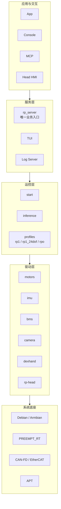

<div align="center">

# RoboOS

**Open operating system for humanoid robots.**
**System · drivers · real-time control · inference · services · APT**

[](https://ros.org)
[](https://www.debian.org)
[](https://www.rock-chips.com)
[](https://www.nvidia.com)
[](https://github.com/Roboparty)

[架构](#architecture) · [核心模块](#modules) · [平台](#platforms) · [快速开始](#quickstart) · [发版与 APT](#release) · [文档](#docs)

</div>

---

> [!NOTE]
> **RoboOS 不是一个新内核。** 它是在 Debian / Armbian、厂商 BSP 和 RoboParty 子仓库之上，定义整机软件边界、启动顺序、控制权、发布与升级方式的操作系统层。

## 为什么是 RoboOS

<table>
<tr>
<td width="50%" valign="top">

### 一套可复现的整机系统
从内核、驱动、运控、策略到服务，全部通过 `manifest.xml` 固定版本，一条 `repo sync` 拉齐。

### 一套唯一的控制入口
整机只暴露一个 `rp-server`。App、Console、MCP、云端都不能绕过租约直接控制电机。

</td>
<td width="50%" valign="top">

### 一套真实的发布链
子仓库独立打 tag、CI 构建 `.deb`、GitHub Release、`routing.yaml` 自动进 APT。

### 一套安全默认值
开机不使能、输入有有效期、停止有回执、维护有互斥；软件停止不等于硬件急停。

</td>
</tr>
</table>

<a id="architecture"></a>
## 架构



部署原则：

- **RK3588 / RoboPi2 = 整机管理节点**：`rp-server`、`start`、`inference`、TUI、诊断、实时 CAN。
- **Orin NX = 计算节点**：感知、语音、对话、技能编排等内部 ROS 2 服务。
- 主节点由部署配置 `manager_node_id` 固定，**不按 IP、上线顺序或算力自动选主**。
- 跨节点控制输入必须带会话与有效期；节点重启或断连后旧会话立即失效。

<a id="modules"></a>
## 核心模块

| 模块 | 作用 |
|---|---|
| [`roboparty-base`](https://github.com/Roboparty/roboparty_base) | 运行环境、权限和基础规则 |
| [`roboparty-description`](https://github.com/Roboparty/roboparty_description) | RP1 / RPO 的 URDF、Mesh、MJCF |
| [`roboparty-motors`](https://github.com/Roboparty/roboparty_motors) | LRO / DM / RP / EVO / XYN 电机驱动与 `motors_py` |
| [`roboparty-imu`](https://github.com/Roboparty/roboparty_imu) | IMU 驱动 |
| [`roboparty-bms`](https://github.com/Roboparty/roboparty_bms) | 电池管理 |
| [`roboparty-camera`](https://github.com/Roboparty/roboparty_camera) | 相机与深度 |
| [`roboparty-lidar`](https://github.com/Roboparty/roboparty_lidar) | 激光雷达驱动占位 |
| [`roboparty-dexhand`](https://github.com/Roboparty/roboparty_dexhand) | 灵巧手驱动 |
| [`roboparty-rp-head`](https://github.com/Roboparty/roboparty_rp_head) | 两轴 LRO 头部控制器与 `roboparty-head` CLI |
| [`roboparty-inference`](https://github.com/Roboparty/roboparty_inference) | ONNX 策略推理、机器人 profile 与运控节点 |
| [`roboparty-start`](https://github.com/Roboparty/roboparty_start) | 启动编排、前台进程管理、ROS 环境探测 |
| [`roboparty-rp-server`](https://github.com/Roboparty/roboparty_rp_server) | 唯一业务入口、配对、租约、停止、App/MCP 网关 |
| [`robopi-tui`](https://github.com/Roboparty/robopi_TUI) | 板端管理、诊断与任务 TUI |
| [`roboparty-analyze`](https://github.com/Roboparty/roboparty_analyze) | 日志封装、七维采集与分析 |
| [`roboparty_log_server`](https://github.com/Roboparty/roboparty_log_server) | 结构化日志与查询 |
| `robopi-addon` / `robopi-firmware` | 板级扩展与固件（经 TUI Recommends 引入） |

> [!TIP]
> 元包 **`roboparty-all`** 汇总常用模块，并且**已包含两轴头部 `roboparty-rp-head`**。无头部机型可换用精简包清单。

<a id="platforms"></a>
## 平台与 APT suite

| suite | 目标 | 典型设备 |
|---|---|---|
| `common` | 架构无关 / 通用用户态 | 所有整机 |
| `robopi0` | RDK X5（hobot-x5） | 视觉/算力板 |
| `robopi1` | Orange Pi 5 Plus | 开发/验证板 |
| `robopi2` | RoboPi2 / RK3588 | 整机主控 |
| `robopi4` | Jetson Orin NX（L4T39） | 算力背包 |
| `x86` | x86 开发 / 仿真 | 桌面环境 |

机器人构型由 inference profile 区分：

| Profile | 机器人 | 电机 |
|---|---|---|
| `rp1` | RP1 全尺寸 | 28 DOF LRO，CAN-FD |
| `rp1_24dof` | RP1 24 DOF | LRO，CAN-FD |
| `rpo` | Roboto Origin | DM，CAN |

```bash
# 启动时显式选择，不做隐式猜测
start_robot.sh --robot rpo --policy default
start_robot.sh --robot rp1 --policy default
```

<a id="quickstart"></a>
## 快速开始

### 1. 同步源码

```bash
repo init -u https://github.com/Roboparty/roboparty_repo.git -b main -m manifest.xml
repo sync -j4
```

### 2. 安装运行环境

```bash
sudo apt update
sudo apt install roboparty-all
```

最小运行链：

```bash
sudo apt install roboparty-start roboparty-inference roboparty-rp-server
```

### 3. 启动

```bash
# 开机默认启动（只提供服务，不自动使能电机）
systemctl status rp-server

# 显式启动运控；现场须确认支撑、急停可达、电源限流
start_robot.sh rpo default
```

### 4. 客户端

- 手机 / 操作台：[`roboparty_joystick`](https://github.com/Roboparty/roboparty_joystick)
- 桌面诊断与数据：[`roboparty_console`](https://github.com/Roboparty/roboparty_console)
- 分支与仓库状态：[`roboparty_manager`](https://github.com/Roboparty/roboparty_manager)

<a id="safety"></a>
## 安全边界

> [!IMPORTANT]
> 开机不隐式使能电机、不复位关节、不启动策略运动。运控启动、策略执行和交互动作都必须经过 `rp-server` 的控制租约。

> [!WARNING]
> 软件停止与硬件急停分开标识。停止失败必须显示“未知/失败”，不能假成功；网络按钮不具备物理急停的可靠性。

- 连续控制输入带有效期；断网、超时或切换来源后旧指令失效。
- 运动、刷写、标定、TUI 写操作共享 `/dev/shm/roboparty-control.lock`。
- LLM / 交互层只能调用白名单技能，不能直接生成电机指令。

<a id="release"></a>
## 发版与 APT


子仓库发版：

```bash
dch -v 2.3.4-1 "fix: ..."
git add .
git commit -m "Bump version to 2.3.4"
git tag v2.3.4
git push origin HEAD --tags
```

根仓库通过 `routing.yaml` 把 Release 资产同步进 APT。完整流程见 [旧版操作说明](scripts/readme.md) 和 [APT 服务器说明](scripts/server.md)。

<details>
<summary><b>展开：仓库结构</b></summary>

```text
roboparty_repo/
├── manifest.xml          # repo 源码清单
├── routing.yaml          # GitHub Release → APT suite 路由
├── .github/workflows/    # APT 同步、看板、量产固件
├── scripts/              # 发版、入库、校验、服务器说明
│   └── readme.md         # 旧版操作说明（源码同步 / 发版 / APT）
├── deb/                  # Debian 包源码（由 manifest 同步）
├── hex/                  # 工具、客户端、日志服务、管理器
├── bsp/                  # 板级 BSP / 内核构建
└── techreport/           # 架构、PRD、现场分析（内部工作区）
```

</details>

<a id="docs"></a>
## 文档

| 文档 | 内容 |
|---|---|
| `techreport/软件架构/上层架构总览.md` | 三个区域、节点关系与主节点规则 |
| `techreport/软件架构/设备连接与运控交互PRD.md` | 配网、配对、启动、控制、停止与异常 |
| `techreport/软件架构/纯软件产品化分析与推进路线.md` | 发布阻断项、任务登记与验收门槛 |
| `techreport/软件架构/产品侧/RoboParty-Console-客户端架构.md` | 桌面客户端架构 |
| [`roboparty_manager`](https://github.com/Roboparty/roboparty_manager) | 仓库分支监控与废弃分支报告 |

<div align="center">

---

**Open hardware. Open intelligence. Shared possibility.**

[roboparty.com](https://roboparty.com) · [GitHub](https://github.com/Roboparty) · [Discord](https://discord.gg/DTcW6rR3Xa)

</div>

## 许可

各子仓库遵循各自仓库中的 `LICENSE`；本仓库只包含清单、路由和发布脚本，不合并子仓库的授权。
